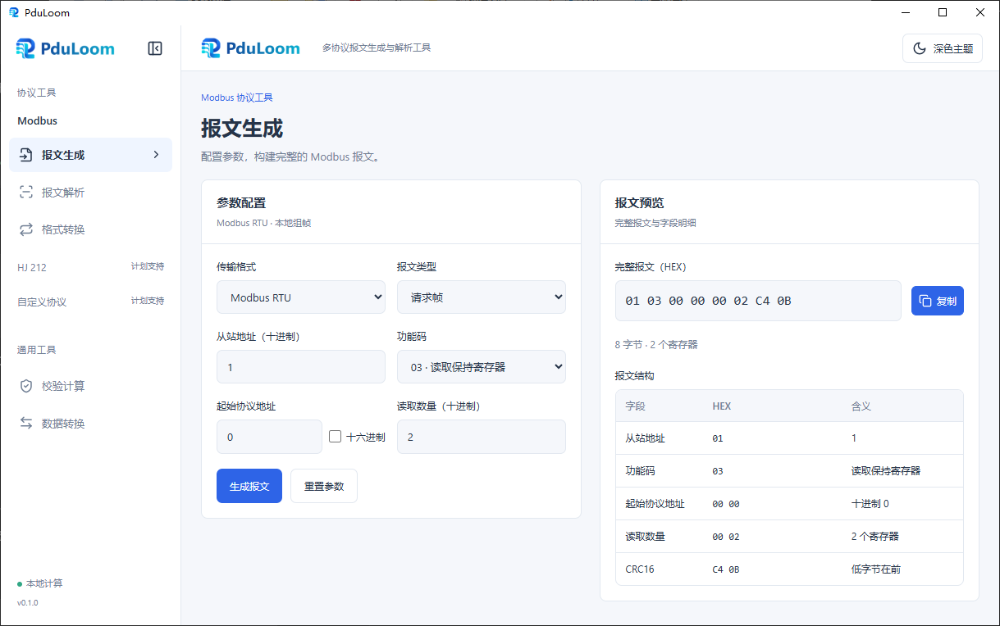

<p align="center">
  
</p>

<p align="center">
  <a href="https://github.com/shy117/PduLoom/releases/latest"></a>
  <a href="LICENSE"></a>
  
</p>

<p align="center">
  
  
  
  
  
  
  
</p>

<p align="center">
  <strong>多协议报文生成与解析工具 · 支持网页版与 Windows 桌面版</strong>
</p>

<p align="center">
  
</p>

所有计算在本地完成，不依赖在线接口或后台服务器。网页版与桌面版共用界面和协议核心。

## 功能

| 功能 | 说明 |
|---|---|
| 报文生成 | 支持 Modbus RTU、ASCII、TCP 的请求、正常响应和异常响应；自动生成校验值或 MBAP 头，展示完整报文、字段及数据明细 |
| 报文解析 | 自动识别单条完整报文的结构，检查校验和协议字段；展示寄存器、状态及自定义规则结果，支持字段与原始字节联动高亮 |
| 格式转换 | RTU、ASCII、TCP 相互转换，保留功能码与业务数据原始字节，重新生成目标封装；支持设置目标设备标识及 TCP 事务标识 |
| 校验计算 | 支持 Modbus CRC16、LRC 的计算和完整数据校验，输出校验字节及追加或替换校验值后的报文 |
| 数据转换 | 十进制数值与 HEX 双向转换，支持数据类型、字节序选择及 UINT16 寄存器视图 |

界面支持浅色与深色主题、可收起导航、响应式布局和统一表格样式。所有复制按钮在成功后显示“已复制”2 秒；输入或配置变化后清除旧结果。

### Modbus 功能码

三种格式共用以下功能码，表中编号为十六进制。

| 功能码 | 功能 |
|---|---|
| `01` | 读取线圈 |
| `02` | 读取离散输入 |
| `03` | 读取保持寄存器 |
| `04` | 读取输入寄存器 |
| `05` | 写单个线圈 |
| `06` | 写单个寄存器 |
| `0F` | 写多个线圈 |
| `10` | 写多个寄存器 |

### 三种传输格式

| 格式 | 报文封装 | 输入与输出 |
|---|---|---|
| RTU | 从站地址、PDU、CRC16；CRC 低字节在前 | 连续 HEX 或空白分隔的完整字节 |
| ASCII | 冒号、地址及 PDU 的 HEX 字符、LRC、CRLF | 完整 ASCII 文本，数据区不含空格 |
| TCP | MBAP 头、PDU；无需 CRC/LRC | 连续 HEX 或空白分隔的完整字节 |

RTU / ASCII 普通从站地址为 1～247，地址 0 仅允许广播写请求。TCP 单元标识为 0～255；事务标识为 0～65535，协议标识固定为 `0000`，MBAP 长度自动计算。

### 数据类型与字节序

支持 `UINT16`、`INT16`、`UINT32`、`INT32`、`UINT64`、`INT64`、`FLOAT32` 和 `FLOAT64`，64 位整数保留完整精度。

| 数据宽度 | 支持的字节序 |
|---|---|
| 16 位 | `AB`、`BA` |
| 32 位 | `ABCD`、`BADC`、`CDAB`、`DCBA` |
| 64 位 | `ABCDEFGH`、`BADCFEHG`、`GHEFCDAB`、`HGFEDCBA` |

字母按标准大端字节编号。协议地址和数量使用大端；数据项可按设备格式选择字节序。

## 使用说明

- **ASCII 结束符**：界面以 `<CR><LF>` 显示结束符，复制时包含实际回车和换行。解析及转换页面将文本框末尾单个 LF 按 CRLF 处理；缺少结束符仍会报告错误。解析页可明确选择“补齐 CRLF 并解析”。
- **解析规则位置**：从 0 开始。RTU 以从站地址为 0；ASCII 以解码后的从站地址为 0，不计冒号和结束符；TCP 使用完整报文偏移，单元标识位于 6，功能码位于 7。
- **自动识别**：解析和格式转换不要求选择报文类型。请求与正常响应结构相同时保留方向不确定的提示，不强行区分。
- **读取响应**：不包含起始协议地址，寄存器按序号展示；线圈和离散输入响应不包含准确请求数量，末字节可能含填充位。状态每行显示 8 个。
- **格式转换**：源校验失败、结构错误或功能码尚未支持时拒绝转换。TCP 转串行格式会移除事务标识；源单元标识超出串行地址范围时需指定目标地址。目标地址 0 按广播写请求规则检查，不改变 PDU 原始字节。
- **校验范围**：校验计算页面只检查 CRC/LRC，不代表业务结构有效。LRC 校验输入为 HEX 字节，不包含 ASCII 文本的冒号和 CRLF；报文解析页面检查完整协议结构，校验失败时仍可查看安全解析的字段。

网页版加载后可断网进行计算；独立桌面程序无需开发服务器即可运行。

## 开发环境

需要 Node.js 20.9 或更高版本及 npm。

构建 Windows 桌面版另外需要：

- Rust 1.90 或更高版本，使用 `x86_64-pc-windows-msvc` 工具链。
- Visual Studio 或 Microsoft C++ Build Tools，包含 MSVC x64 编译工具和 Windows SDK。
- Microsoft Edge WebView2 Runtime。

首次安装依赖和构建需要联网。以下命令均在项目根目录执行。

## 运行与构建

### 网页版

```sh
# 安装依赖
npm install

# 启动开发服务
npm run dev

# 构建生产版本（包含 TypeScript 类型检查）
npm run build

# 预览构建结果
npm run preview
```

开发地址默认为 `http://127.0.0.1:5173`，构建产物位于 `dist/`。

### Windows 桌面版

```sh
# 启动桌面开发程序，同时启动 Vite 服务
npx tauri dev

# 构建独立程序，不生成安装包
npx tauri build --no-bundle
```

运行 `npx tauri dev` 前，应停止已占用 5173 端口的开发服务。

独立程序输出为 `src-tauri/target/release/PduLoom.exe`，运行时需要 WebView2 Runtime，无需 Node.js、Rust 或 Vite 服务。开发模式程序位于 `src-tauri/target/debug/PduLoom.exe`，仍依赖 Vite 服务。

## 测试与验证

```sh
# 运行 Vitest 单元测试
npm test

# 单独执行 TypeScript 类型检查
npm run typecheck
```

协议测试使用独立标准向量，覆盖三种格式的生成、解析、转换，CRC/LRC、MBAP、数量与地址边界、异常输入、字节序及数据精度。构建通过不等同于功能验证通过；布局、交互、主题和响应式效果需要单独进行界面测试。

## 当前范围与后续扩展

当前支持上述八种 Modbus 功能码的单条离线报文处理。以下功能尚未实现：

- 批量报文拆分、TCP 流重组及请求响应配对。
- 自定义解析规则保存。
- 其他 Modbus 功能码、自定义 ASCII 结束符。
- HJ 212、自定义协议。

实际串口和网络通信不属于项目范围。

## 项目结构

```text
src/
  core/
    modbus/     共用业务处理、RTU / ASCII / TCP 封装与格式转换
    checksum/   CRC16、LRC 校验算法
    hex.ts      HEX 输入处理
    data-conversion.ts  数据类型与字节序转换
  components/   公共卡片、表格及复制按钮
  views/        五个功能页面
  ui/           导航和主题配置
src-tauri/      Windows 桌面入口与配置
tests/          单元测试
```

协议核心不依赖 Vue 或 Tauri。接口说明见 [src/core/README.md](src/core/README.md)，开发协作规范见 [AGENTS.md](AGENTS.md)。

## 相关文档

- [版本变更](CHANGELOG.md)
- [发布说明](RELEASE.md)
- [发布包制作](docs/PACKAGING.md)
- [项目声明](NOTICE)

第三方依赖保持各自的许可证及版权声明，发布包应附带适用的第三方许可证。
